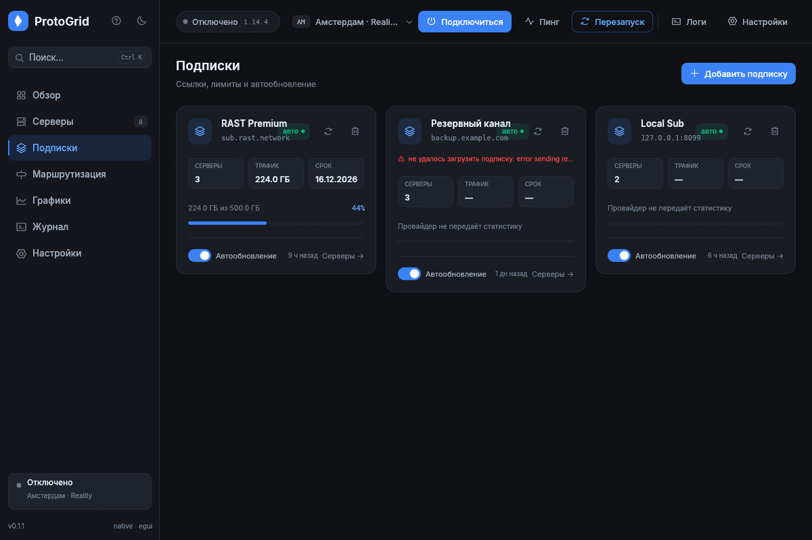

# ProtoGrid

**ProtoGrid** — нативный кроссплатформенный клиент для прокси на Rust. Интерфейс построен на **egui/eframe**: без WebView, HTML, JavaScript и Node.js. Приложение само генерирует конфигурации и запускает **sing-box** или **Xray-core**, а вы управляете серверами, подписками, маршрутизацией и режимом подключения из одного окна.

**Статус:** публичная бета.

**Сайт:** <https://gimmickfive.github.io/ProtoGrid/> · **Релизы:** <https://github.com/GimmickFive/ProtoGrid/releases>

<p align="center">
  
</p>

## Почему нативно

- Окно и весь UI рисуются Rust-кодом через egui/OpenGL.
- Нет WebView2/WebKitGTK, нет HTML/CSS/JS и нет Node.js.
- Компактный бинарник-лончер; оба варианта ProtoGrid-core лежат рядом (`protogrid-core.exe` и облегчённый `protogrid-core-lite.exe`) и не встраиваются в него, поэтому запуск не раздувается. Меньше памяти и никаких webview-процессов.
- Тяжёлая работа с сетью, ядрами и системным прокси — в отдельном Rust-движке `protogrid-core`.

## Возможности

- **Импорт**: одно поле для ссылок, URL подписки, Clash YAML и профиля `.ovpn` — формат определяется автоматически. QR-код можно отсканировать камерой (Android) или распознать из изображения (Android и ПК); вставка из буфера и выбор файла `.ovpn` — отдельными кнопками.
- **Подписки**: base64, списки ссылок, Clash/Clash.Meta YAML, трафик и срок из `subscription-userinfo`, автообновление раз в 12 часов. Ссылка подписки принимается только по HTTPS, чтобы токен не уходил открытым текстом.
- **Настройки**: экспорт и импорт JSON с настройками, правилами и профилями маршрутизации. Серверы, UUID, пароли и токены подписок в файл не попадают.
- **Три ядра, у ProtoGrid два варианта**: ProtoGrid-core (обычный — XHTTP/MASQUE/XDRIVE, и Lite — только VLESS/Reality по TCP с TUN и mixed), sing-box и Xray-core — у каждого свой бинарник и путь, автоопределение версии; стоковые ядра можно скачать с GitHub.
- **Обновления**: проверка новых релизов ProtoGrid, sing-box и Xray-core на GitHub при запуске и по кнопке. Файл скачивается только после подтверждения, с проверкой размера и SHA-256; Android-клиент скачивает APK и открывает системный установщик. ProtoGrid-core входит в сборку и обновляется вместе с приложением.
- **OpenVPN**: через штатный endpoint sing-box 1.14+ (`with_openvpn`), только на sing-box-подобных ядрах; внешний бинарник `openvpn` не нужен.
- **Подключение**: системный прокси (Windows / GNOME / KDE / macOS), TUN (sing-box), локальные HTTP/SOCKS-порты.
- **Маршрутизация**: пресеты «Жизнь в РФ / Глобальный прокси / Прямой», несколько собственных профилей (копия текущего набора правил или пустой), правила по доменам, IP/CIDR, GeoIP, GeoSite и процессам. Стартовый слепок `geoip-ru`/`category-ru` входит в сборку (Android — в `.so`, desktop — рядом с exe), обновляется из GitHub раз в 7 дней; при недоступности сети используется зашитая/упакованная или последняя скачанная копия.
- **Задержки**: прямой TCP-RTT (медиана из 3 проб, DNS и туннель не входят) и HTTP TTFB через узел (Clash API / локальный прокси) — две отдельные колонки, потому что это разные метрики.
- **Журнал**: каналы `IN`/`TUN`/`PROXY`/`DIRECT`/`BLOCK`/`DNS`/`PROC`/`SYS`/`APP` с расшифровкой, фильтры по уровню, каналу и тексту, пауза, копирование и сохранение.
- **Трей и автозапуск**: меню в трее, сворачивание окна, запуск при входе в систему.
- **Один экземпляр**: повторный запуск не открывает вторую копию, а поднимает и фокусирует уже работающее окно, даже если оно свёрнуто или скрыто в трее (Windows, Linux, macOS).
- **Интерфейс**: единый нативный лейаут — тёмный сайдбар, верхняя панель действий, обзор с карточками и живыми графиками, таблица серверов, подписки, маршрутизация, графики трафика, журнал, настройки и раздел «Информация» с наглядным руководством по ядрам, протоколам и TUN. Тёмная и светлая темы, русский язык, поиск (`Ctrl K`), быстрые переходы (`Ctrl 1…8`), трей и автозапуск.

## Скриншоты

| Обзор | Светлая тема |
|---|---|
|  |  |

| Серверы | Подписки |
|---|---|
|  |  |

| Маршрутизация | Графики |
|---|---|
|  |  |

| Журнал | Настройки |
|---|---|
|  |  |

| Импорт серверов | |
|---|---|
|  | |

## Платформы

| Платформа | Системный прокси | TUN | Автозапуск | Трей |
|---|---|---|---|---|
| Windows 10/11 | да (реестр + WinINet) | да, sing-box + wintun.dll | да (HKCU Run) | да |
| Linux (GNOME/KDE) | да (gsettings / kwriteconfig) | да, нужны root/CAP_NET_ADMIN | да (XDG autostart) | да при наличии StatusNotifier-хоста |
| macOS | да (networksetup) | да, нужны права | да (LaunchAgent) | да |

В Android-клиенте системного прокси нет: трафик забирает `VpnService` + TUN (`gvisor`), настройки Wi-Fi proxy приложение не меняет.

В Linux-окружениях без StatusNotifier (например, WSL или голый WM) иконка трея не создаётся, а настройка сворачивания в трей отключается — окно закрывается полностью.

## Требования

- Rust **1.95+** (egui 0.36; проект собран на stable 1.100).
- Linux-зависимости:
  ```bash
  sudo apt install build-essential pkg-config libssl-dev \
    libxkbcommon-dev libxkbcommon-x11-0 libwayland-dev libx11-dev libgl1-mesa-dev \
    libgtk-3-dev libayatana-appindicator3-dev
  ```
- Windows: Rust MSVC или GNU toolchain. **WebView2 не нужен.**
- macOS: Xcode Command Line Tools.
- Ядро:
  - **sing-box 1.12+** (проверено на 1.14.4);
  - **Xray-core** (проверено на 26.11.9).
- **OpenVPN** — только sing-box 1.14+ с тегом сборки `with_openvpn`: подходят официальные релизы, ProtoGrid-core собирается с этим тегом. Xray-core OpenVPN не поддерживает.

Стоковые ядра можно скачать в **Настройки → Подключение** или указать путь вручную. Оба варианта ProtoGrid-core поставляются рядом с приложением как `protogrid-core.exe` и `protogrid-core-lite.exe` (Windows) или `protogrid-core` и `protogrid-core-lite` (Linux) и подхватываются автоматически. В настройках выбирается один пункт «ProtoGrid», внутри которого переключается обычный вариант и Lite. Lite понимает только VLESS/Reality по TCP, зато меньше и быстрее собирается; TUN и mixed-порт в нём сохранены.

## Сборка и запуск

```bash
git clone <repo>
cd ProtoGrid

cargo test -p protogrid-core          # тесты ядра
cargo run -p protogrid-desktop        # запуск
cargo build --release -p protogrid-desktop
```

Бинарник: `target/release/protogrid` (Linux/macOS) или `target/release/protogrid.exe` (Windows). Node.js/npm не используются.

### Windows-сборка

На Windows с MSVC:

```powershell
cargo build --release -p protogrid-desktop
```

Кросс-сборка из Linux через MinGW:

```bash
rustup target add x86_64-pc-windows-gnu
cargo build --release -p protogrid-desktop --target x86_64-pc-windows-gnu
# результат: target/x86_64-pc-windows-gnu/release/protogrid.exe
```

В отличие от старой Tauri-версии, здесь нет WebView и `WebView2Loader.dll`; exe зависит только от системных DLL Windows.

Готовые Windows-пакеты собирает `scripts/package-windows.sh`: установщик NSIS и портативный zip. В обоих `protogrid-core.exe`, `protogrid-core-lite.exe`, `wintun.dll` и `reset-tun.bat` лежат рядом с `ProtoGrid.exe`, а не внутри него. `reset-tun.bat` удаляет зависшие Wintun-адаптеры, если TUN не запускается после аварийного завершения.

Ядра форка собирает `scripts/build-fork.sh`: полный ProtoGrid-core (все протоколы и транспорты) и ProtoGrid-core Lite (`protogrid_lite`, только VLESS/Reality по TCP) под Linux, Windows и macOS.

### Android (APK)

Android-клиент — отдельный MVP в `apps/protogrid-android`: обзор, серверы, маршрутизация по приложениям и трафику (включая GeoIP/GeoSite), мониторинг. Kotlin/Compose, `VpnService` и ProtoGrid-core (`libbox`); ссылки и конфиги разбирает общий `protogrid-core` через `crates/protogrid-mobile` (JNI). Релиз собирается под `arm64-v8a`, для эмулятора — `x86_64`.

В одном релизе выходят два APK с одним ядром внутри: обычный `ProtoGrid-<версия>-arm64-v8a.apk` и лёгкий `ProtoGrid-<версия>-lite-arm64-v8a.apk`. Lite-ядро понимает только VLESS/Reality по TCP, зато занимает меньше места; у него отдельный `applicationId` (`app.protogrid.client.lite`), поэтому оба варианта можно держать установленными рядом.

```bash
# libbox (полный и Lite) + Rust-мост
export CGO_LDFLAGS_ALLOW='-l:.*'   # Go 1.27 и cronet-go
cd forks/sing-box && make lib_install
go run ./cmd/internal/build_libbox -target android -platform android/arm64 \
  -output libbox.aar
go run ./cmd/internal/build_libbox -target android -platform android/arm64 \
  -tags "protogrid_lite,with_utls,with_clash_api,with_gvisor" \
  -output libbox-lite.aar -legacy=false
cd ../..
cp forks/sing-box/libbox.aar apps/protogrid-android/app/libs/libbox.aar
cp forks/sing-box/libbox-lite.aar apps/protogrid-android/app/libs/libbox-lite.aar
cargo ndk -t arm64-v8a -o apps/protogrid-android/app/src/main/jniLibs \
  build -p protogrid-mobile --release

cd apps/protogrid-android
./gradlew :app:assembleStandardRelease :app:assembleLiteRelease
```

APK прикрепляются к GitHub Release workflow `.github/workflows/android.yml` по тегу `android-v*` — обычный и Lite. Нужны JDK 17, Android SDK 35 и платформа 24 (libbox собирается с `-androidapi 24`), NDK 28.0.13004108, Go 1.27 и `cargo-ndk`; подпись и секреты описаны в [apps/protogrid-android/README.md](apps/protogrid-android/README.md).

Ту же цепочку можно запустить одной командой: `ANDROID_HOME=/path/to/sdk ./scripts/build-android.sh`. Для x86_64-эмулятора — `./scripts/build-android.sh x86_64`.

Android-модуль линкует `libbox` (sing-box, GPLv3), поэтому распространяется под GPL-3.0; общий Rust-код остаётся MIT.

## Где лежат данные

| ОС | Путь |
|---|---|
| Windows | `%APPDATA%\app.protogrid.client` |
| Linux | `~/.local/share/app.protogrid.client` |
| macOS | `~/Library/Application Support/app.protogrid.client` |

Внутри:

- `config.json` — серверы, подписки, правила, настройки;
- `runtime/singbox.json` или `runtime/xray.json` — последний конфиг ядра;
- `cores/` — скачанные sing-box/Xray и файлы GeoIP/GeoSite (ядро ProtoGrid хранится рядом с приложением);
- `rulesets/` — кэш `*.srs` баз правил sing-box. При первом запуске заполняется зашитым слепком `geoip-ru`/`category-ru`, затем обновляется раз в 7 дней; при недоступности сети используются зашитая/сохранённая копия, отсутствующие правила пропускаются.

## Совместимость протоколов

### sing-box

| Протокол | Транспорты | Примечания |
|---|---|---|
| VLESS | TCP, WebSocket, gRPC, HTTP/2, HTTP Upgrade, XHTTP*, mKCP | TLS, Reality, Vision, XUDP, VLESS Encryption |
| VMess | TCP, WebSocket, gRPC, HTTP/2, HTTP Upgrade, XHTTP*, mKCP | alterId, auto/AEAD |
| Trojan | TCP, WebSocket, gRPC, HTTP/2, HTTP Upgrade, XHTTP*, mKCP | TLS |
| Shadowsocks | TCP | SIP002/legacy, `obfs-local`, `v2ray-plugin` |
| Hysteria2 | QUIC | Salamander obfs, up/down |
| TUIC | QUIC | congestion control, UDP relay mode |
| OpenVPN | UDP, TCP | endpoint, профиль `.ovpn`, TLS, `auth-user-pass`, `tls-auth`/`tls-crypt` |

`*` XHTTP в sing-box доступен только в ProtoGrid-core; стоковый sing-box его не поддерживает. mKCP, VLESS Encryption и UDP noise (Xray `finalmask`) также добавлены в форк. См. `docs/xhttp-fork-plan.md` и `docs/xray-parity-plan.md`.

ProtoGrid-core Lite — отдельная сборка того же форка только с VLESS (TCP, TLS/Reality), TUN, mixed-входом и Clash API. Остальные протоколы и транспорты в неё не попадают: приложение просто не предложит их для этого ядра.

### Xray-core

| Протокол | Транспорты | Примечания |
|---|---|---|
| VLESS | TCP, WebSocket, gRPC, HTTP Upgrade, XHTTP, mKCP | TLS, Reality, Vision, VLESS Encryption |
| VMess | TCP, WebSocket, gRPC, HTTP Upgrade, XHTTP, mKCP | |
| Trojan | TCP, WebSocket, gRPC, HTTP Upgrade, XHTTP, mKCP | |
| Shadowsocks | TCP | SIP003-плагины при наличии исполняемого файла |

Ограничения Xray:

- **Hysteria2 и TUIC не поддерживаются** — переключите ядро на sing-box.
- **HTTP/2 (`type=http`/`h2`) удалён в Xray 26** — используйте XHTTP или sing-box.
- **TUN-режим недоступен** — только sing-box.
- TCP-RTT измеряется напрямую для любого сервера; HTTP TTFB через узел доступен для активного сервера через локальный прокси.

## TUN-режим

- **Windows**: права администратора + `wintun.dll` рядом с исполняемым файлом ядра (в готовых пакетах — рядом с `ProtoGrid.exe`; для стокового sing-box — папка `cores/sing-box`). Wintun: <https://www.wintun.net/>.
- **Linux**: root или `CAP_NET_ADMIN`.
- **macOS**: запуск с правами администратора.

## Архитектура

```
.
├── crates/protogrid-core/     # модели, ссылки, подписки, Clash YAML, конфиги
│                              # sing-box/Xray, OpenVPN, GeoIP, RTT/TTFB, системный прокси
├── apps/protogrid-desktop/    # нативное приложение egui/eframe
│   ├── src/app.rs             # окно, трей, тема, жизненный цикл
│   ├── src/engine.rs          # состояние, процессы ядер, подписки, RTT/TTFB, логи
│   ├── src/installer.rs       # поиск/скачивание/распаковка ядер
│   ├── src/ui.rs              # все экраны, формы и модальные окна
│   ├── src/flags.rs           # флаги стран из assets/flags.rgba
│   └── assets/                # шрифты, флаги, иконка
└── docs/                      # скриншоты, патчи форка, планы
```

- При подключении генерируется JSON-конфиг, запускается ядро дочерним процессом и проверяется открытие локального порта.
- В sing-box все серверы попадают в `selector`, Clash API умеет измерять HTTP TTFB каждого узла.
- В Xray включается только активный сервер; при переключении конфиг пересобирается.
- Секреты и подписки остаются локально; телеметрии нет.

## Проверка

- 103 юнит-теста `protogrid-core`; `cargo check` для desktop и mobile проходит.
- Конфиги проверены на **sing-box 1.14.4** и **Xray 26.11.9**.
- Реальное подключение через оба ядра проверено на Linux.
- Код приложения проходит `cargo check` под Windows-таргет и собирается в нативный `.exe`.

## Метрики задержки

В таблице серверов две независимые колонки, и их значения нельзя сравнивать между собой:

- **RTT** — прямой TCP-handshake до адреса из конфига, медиана из 3 проб. DNS-резолв
  выполняется один раз и в таймер не входит. При включённом TUN RTT не измеряется:
  `connect()` ответил бы локальный стек ядра (~0–1 мс). Для UDP-транспортов
  (Hysteria2, TUIC, OpenVPN UDP) TCP-порта нет, поэтому RTT остаётся пустым.
  За CDN/anycast это RTT до edge, а не до самого сервера.
- **TTFB** — HTTP TTFB через узел: полный запрос к «URL проверки» через локальный
  прокси (активный сервер) или Clash API (остальные узлы sing-box), медиана из 3
  проб. Включает установку туннеля, TCP/TLS до целевого сайта и его ответ, поэтому
  всегда больше RTT. Это не задержка узла.

ICMP не используется: raw-сокеты требуют прав и часто фильтруются провайдером.

## Ограничения

- Нет ShadowsocksR (`ssr://`), Hysteria v1, WireGuard и цепочек прокси.
- XHTTP в стоковом sing-box не поддерживается; нужен ProtoGrid-core. XHTTP-серверная сторона в форке пока не реализована.
- mKCP, VLESS Encryption, XHTTP/3 и UDP noise (`finalmask`) доступны только в ProtoGrid-core. Noise маскирует только исходящие UDP-сокеты (mKCP, QUIC/HTTP3); для TCP-транспортов он не действует.
- XDRIVE local и S3 проверены; Google Drive требует OAuth-учётных данных. Reality ML-DSA-65 проверен на production; MASQUE TCP/UDP работает.
- Нет автоматического скачивания `wintun.dll`.
- Системный прокси переключается целиком; прежние ручные настройки не восстанавливаются.
- Нет синхронизации настроек и защиты от запуска второй копии.

### OpenVPN

- Нет obfuscation и XOR/scramble, `obfsproxy` и `--plugin`; поддержаны только штатные TLS, `tls-auth`, `tls-crypt` и `tls-crypt-v2`.
- Нет TAP/L2 и DCO — только tun (L3) и userspace-стек sing-box.
- `<connection>`-блоки не раскрываются: в профиле должен быть top-level `remote`.
- Для UDP-серверов TCP-RTT не работает; HTTP TTFB через узел показывается через Clash API, когда ядро подключено.
- Профиль `.ovpn` вместе с встроенными ключами и паролями хранится в `config.json` открытым текстом, как и остальные секреты приложения; в логи не пишется.
- OpenVPN работает только на sing-box-подобном ядре 1.14+ с `with_openvpn`; Xray-core его не поддерживает.

## Лицензия

Код desktop-приложения и общее ядро — MIT, см. [LICENSE](LICENSE).
Android-клиент линкует `libbox` (sing-box, GPLv3) и распространяется под
GPL-3.0, см. [apps/protogrid-android/LICENSE](apps/protogrid-android/LICENSE).
Сторонние компоненты и их лицензии — в
[THIRD_PARTY_NOTICES.md](THIRD_PARTY_NOTICES.md): шрифты Inter,
JetBrains Mono и DejaVu — OFL, патчи форка sing-box — GPLv3.

## Участие и релизы

- [CHANGELOG.md](CHANGELOG.md) — что изменилось в каждом релизе.
- [CONTRIBUTING.md](CONTRIBUTING.md) — ветки, стиль коммитов, проверки.
- [docs/releasing.md](docs/releasing.md) — как выпускается релиз.
- [SECURITY.md](SECURITY.md) — как сообщить об уязвимости.
