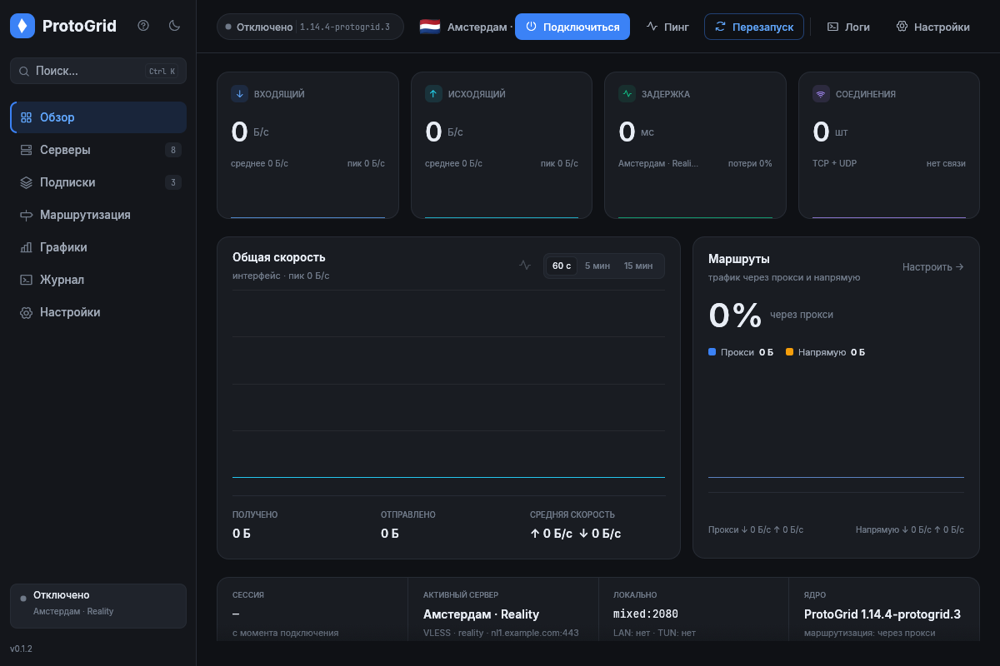
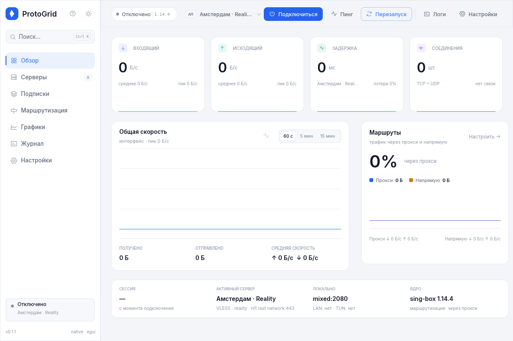
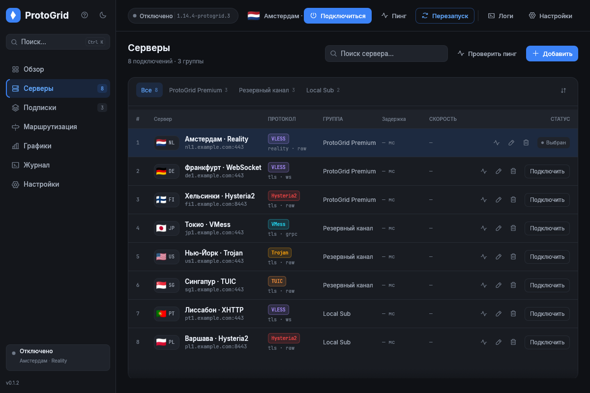
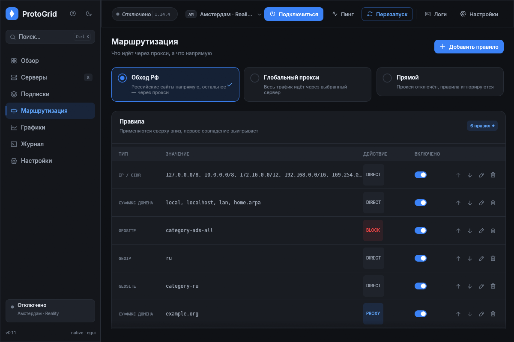
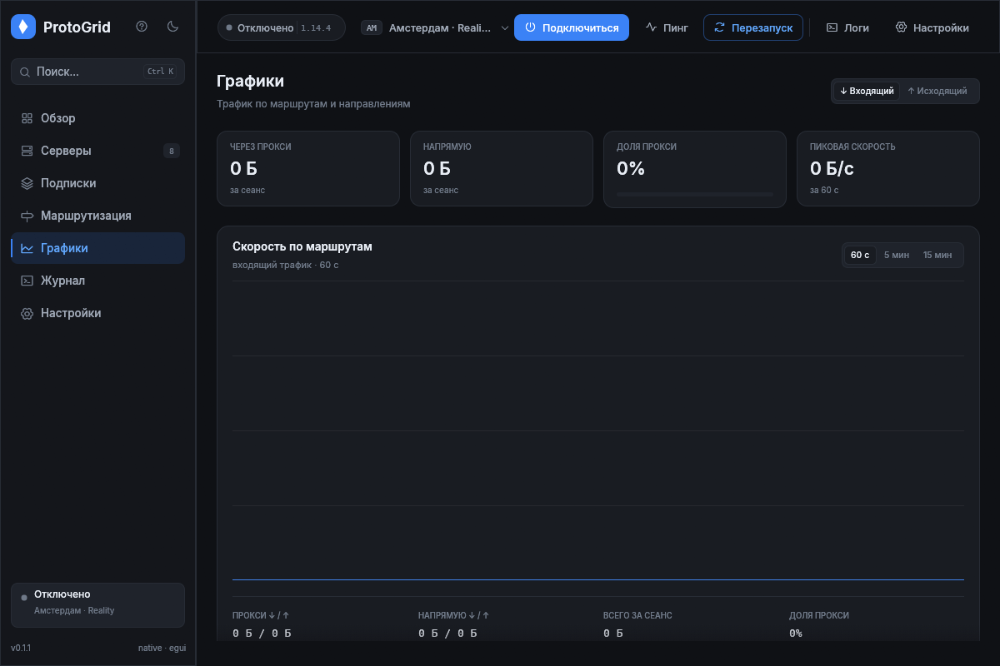
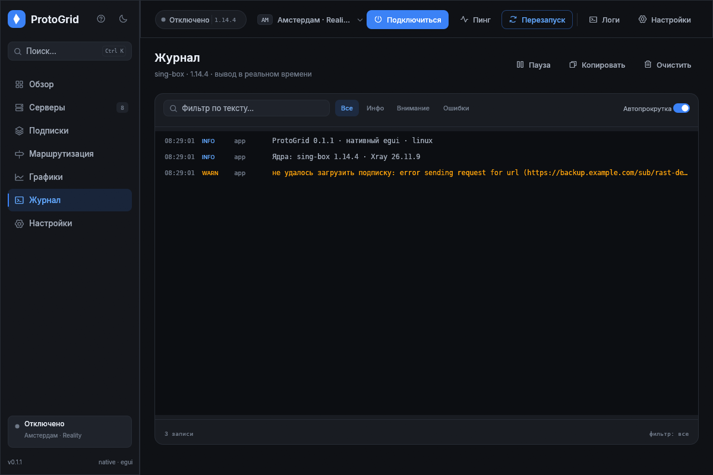
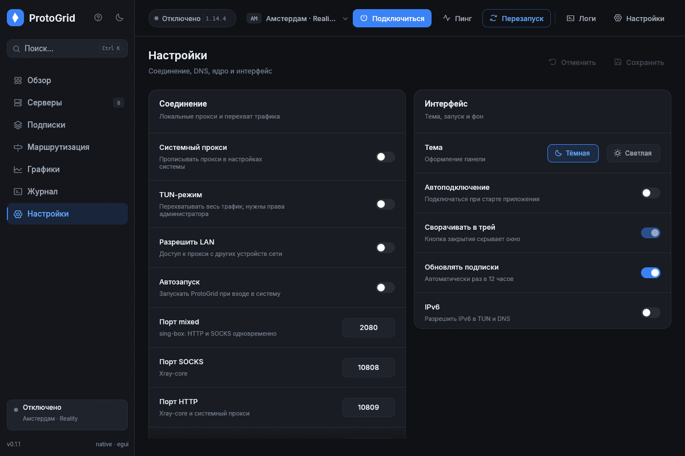
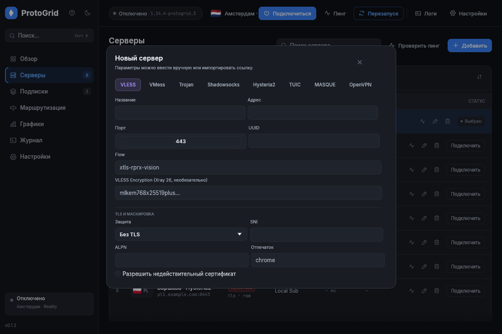

# ProtoGrid

**ProtoGrid** — нативный кроссплатформенный клиент для прокси на Rust. Интерфейс построен на **egui/eframe**: без WebView, HTML, JavaScript и Node.js. Приложение само генерирует конфигурации и запускает **sing-box** или **Xray-core**, а вы управляете серверами, подписками, маршрутизацией и режимом подключения из одного окна.

**Статус:** публичная бета.

<p align="center">
  
</p>

## Почему нативно

- Окно и весь UI рисуются Rust-кодом через egui/OpenGL.
- Нет WebView2/WebKitGTK, нет HTML/CSS/JS и нет Node.js.
- Компактный бинарник-лончер; ядро ProtoGrid лежит рядом (`protogrid-core.exe`) и не встраивается в него, поэтому запуск не раздувается. Меньше памяти и никаких webview-процессов.
- Тяжёлая работа с сетью, ядрами и системным прокси — в отдельном Rust-движке `protogrid-core`.

## Возможности

- **Импорт ссылок**: `vless://`, `vmess://`, `trojan://`, `ss://`, `hysteria2://` (`hy2://`), `tuic://`, `ovpn://`/`openvpn://` (base64 профиля), файл `.ovpn` (OpenVPN), вставка из буфера.
- **Подписки**: base64, списки ссылок, Clash/Clash.Meta YAML, трафик и срок из `subscription-userinfo`, автообновление раз в 12 часов.
- **Три ядра**: ProtoGrid (форк sing-box с XHTTP/MASQUE/XDRIVE), sing-box и Xray-core — у каждого свой бинарник и путь, автоопределение версии; стоковые ядра можно скачать с GitHub.
- **OpenVPN**: через штатный endpoint sing-box 1.14+ (`with_openvpn`), только на sing-box-подобных ядрах; внешний бинарник `openvpn` не нужен.
- **Подключение**: системный прокси (Windows / GNOME / KDE / macOS), TUN (sing-box), локальные HTTP/SOCKS-порты.
- **Маршрутизация**: пресеты «Умный обход / Глобально / Напрямую», правила по доменам, IP/CIDR, GeoIP, GeoSite и процессам. Базы GeoIP/GeoSite кэшируются, поэтому после первого запуска подключение не зависит от доступности GitHub.
- **Пинг**: TCP, реальная задержка через Clash API sing-box, проверка текущего соединения через локальный прокси.
- **Трей и автозапуск**: меню в трее, сворачивание окна, запуск при входе в систему.
- **Интерфейс**: единый нативный лейаут — тёмный сайдбар, верхняя панель действий, обзор с карточками и живыми графиками, таблица серверов, подписки, маршрутизация, графики трафика, журнал и настройки. Тёмная и светлая темы, русский язык, поиск (`Ctrl K`), быстрые переходы (`Ctrl 1…7`), трей и автозапуск.

## Скриншоты

| Обзор | Светлая тема |
|---|---|
|  |  |

| Серверы | Подписки |
|---|---|
|  |  |

| Маршрутизация | Графики |
|---|---|
|  |  |

| Журнал | Настройки |
|---|---|
|  |  |

| Импорт серверов | |
|---|---|
|  | |

## Платформы

| Платформа | Системный прокси | TUN | Автозапуск | Трей |
|---|---|---|---|---|
| Windows 10/11 | да (реестр + WinINet) | да, sing-box + wintun.dll | да (HKCU Run) | да |
| Linux (GNOME/KDE) | да (gsettings / kwriteconfig) | да, нужны root/CAP_NET_ADMIN | да (XDG autostart) | да при наличии StatusNotifier-хоста |
| macOS | да (networksetup) | да, нужны права | да (LaunchAgent) | да |

В Linux-окружениях без StatusNotifier (например, WSL или голый WM) иконка трея не создаётся, а настройка сворачивания в трей отключается — окно закрывается полностью.

## Требования

- Rust **1.95+** (egui 0.36; проект собран на stable 1.100).
- Linux-зависимости:
  ```bash
  sudo apt install build-essential pkg-config libssl-dev \
    libxkbcommon-dev libxkbcommon-x11-0 libwayland-dev libx11-dev libgl1-mesa-dev \
    libgtk-3-dev libayatana-appindicator3-dev
  ```
- Windows: Rust MSVC или GNU toolchain. **WebView2 не нужен.**
- macOS: Xcode Command Line Tools.
- Ядро:
  - **sing-box 1.12+** (проверено на 1.14.4);
  - **Xray-core** (проверено на 26.11.9).
- **OpenVPN** — только sing-box 1.14+ с тегом сборки `with_openvpn`: подходят официальные релизы, форк ProtoGrid собирается с этим тегом. Xray-core OpenVPN не поддерживает.

Стоковые ядра можно скачать в **Настройки → Подключение** или указать путь вручную. Ядро ProtoGrid (форк sing-box) поставляется рядом с приложением как `protogrid-core.exe` (Windows) или `protogrid-core` (Linux) и подхватывается автоматически.

## Сборка и запуск

```bash
git clone <repo>
cd ProtoGrid

cargo test -p protogrid-core          # тесты ядра
cargo run -p protogrid-desktop        # запуск
cargo build --release -p protogrid-desktop
```

Бинарник: `target/release/protogrid` (Linux/macOS) или `target/release/protogrid.exe` (Windows). Node.js/npm не используются.

### Windows-сборка

На Windows с MSVC:

```powershell
cargo build --release -p protogrid-desktop
```

Кросс-сборка из Linux через MinGW:

```bash
rustup target add x86_64-pc-windows-gnu
cargo build --release -p protogrid-desktop --target x86_64-pc-windows-gnu
# результат: target/x86_64-pc-windows-gnu/release/protogrid.exe
```

В отличие от старой Tauri-версии, здесь нет WebView и `WebView2Loader.dll`; exe зависит только от системных DLL Windows.

Готовые Windows-пакеты собирает `scripts/package-windows.sh`: установщик NSIS и портативный zip. В обоих `protogrid-core.exe` и `wintun.dll` лежат рядом с `ProtoGrid.exe`, а не внутри него.

## Где лежат данные

| ОС | Путь |
|---|---|
| Windows | `%APPDATA%\app.protogrid.client` |
| Linux | `~/.local/share/app.protogrid.client` |
| macOS | `~/Library/Application Support/app.protogrid.client` |

Внутри:

- `config.json` — серверы, подписки, правила, настройки;
- `runtime/singbox.json` или `runtime/xray.json` — последний конфиг ядра;
- `cores/` — скачанные sing-box/Xray и файлы GeoIP/GeoSite (ядро ProtoGrid хранится рядом с приложением);
- `rulesets/` — кэш `*.srs` баз правил sing-box (обновление раз в 7 дней; при недоступности сети используются сохранённые копии, отсутствующие правила пропускаются).

## Совместимость протоколов

### sing-box

| Протокол | Транспорты | Примечания |
|---|---|---|
| VLESS | TCP, WebSocket, gRPC, HTTP/2, HTTP Upgrade, XHTTP*, mKCP | TLS, Reality, Vision, XUDP, VLESS Encryption |
| VMess | TCP, WebSocket, gRPC, HTTP/2, HTTP Upgrade, XHTTP*, mKCP | alterId, auto/AEAD |
| Trojan | TCP, WebSocket, gRPC, HTTP/2, HTTP Upgrade, XHTTP*, mKCP | TLS |
| Shadowsocks | TCP | SIP002/legacy, `obfs-local`, `v2ray-plugin` |
| Hysteria2 | QUIC | Salamander obfs, up/down |
| TUIC | QUIC | congestion control, UDP relay mode |
| OpenVPN | UDP, TCP | endpoint, профиль `.ovpn`, TLS, `auth-user-pass`, `tls-auth`/`tls-crypt` |

`*` XHTTP в sing-box доступен только в форке ProtoGrid; стоковый sing-box его не поддерживает. mKCP, VLESS Encryption и UDP noise (Xray `finalmask`) также добавлены в форк. См. `docs/xhttp-fork-plan.md` и `docs/xray-parity-plan.md`.

### Xray-core

| Протокол | Транспорты | Примечания |
|---|---|---|
| VLESS | TCP, WebSocket, gRPC, HTTP Upgrade, XHTTP, mKCP | TLS, Reality, Vision, VLESS Encryption |
| VMess | TCP, WebSocket, gRPC, HTTP Upgrade, XHTTP, mKCP | |
| Trojan | TCP, WebSocket, gRPC, HTTP Upgrade, XHTTP, mKCP | |
| Shadowsocks | TCP | SIP003-плагины при наличии исполняемого файла |

Ограничения Xray:

- **Hysteria2 и TUIC не поддерживаются** — переключите ядро на sing-box.
- **HTTP/2 (`type=http`/`h2`) удалён в Xray 26** — используйте XHTTP или sing-box.
- **TUN-режим недоступен** — только sing-box.
- Задержка неактивных серверов проверяется по TCP; реальная задержка доступна для активного сервера через локальный прокси.

## TUN-режим

- **Windows**: права администратора + `wintun.dll` рядом с исполняемым файлом ядра (в готовых пакетах — рядом с `ProtoGrid.exe`; для стокового sing-box — папка `cores/sing-box`). Wintun: <https://www.wintun.net/>.
- **Linux**: root или `CAP_NET_ADMIN`.
- **macOS**: запуск с правами администратора.

## Архитектура

```
.
├── crates/protogrid-core/     # модели, ссылки, подписки, Clash YAML, конфиги
│                              # sing-box/Xray, OpenVPN, GeoIP, ping, системный прокси
├── apps/protogrid-desktop/    # нативное приложение egui/eframe
│   ├── src/app.rs             # окно, трей, тема, жизненный цикл
│   ├── src/engine.rs          # состояние, процессы ядер, подписки, пинг, логи
│   ├── src/installer.rs       # поиск/скачивание/распаковка ядер
│   ├── src/ui.rs              # все экраны, формы и модальные окна
│   ├── src/flags.rs           # флаги стран из assets/flags.rgba
│   └── assets/                # шрифты, флаги, иконка
└── docs/                      # скриншоты, патчи форка, планы
```

- При подключении генерируется JSON-конфиг, запускается ядро дочерним процессом и проверяется открытие локального порта.
- В sing-box все серверы попадают в `selector`, Clash API умеет измерять задержку каждого узла.
- В Xray включается только активный сервер; при переключении конфиг пересобирается.
- Секреты и подписки остаются локально; телеметрии нет.

## Проверка

- 87 юнит-тестов `protogrid-core`, `cargo clippy` без предупреждений.
- Конфиги проверены на **sing-box 1.14.4** и **Xray 26.11.9**.
- Реальное подключение через оба ядра проверено на Linux.
- Код приложения проходит `cargo check` под Windows-таргет и собирается в нативный `.exe`.

## Ограничения

- Нет ShadowsocksR (`ssr://`), Hysteria v1, WireGuard и цепочек прокси.
- XHTTP в стоковом sing-box не поддерживается; нужен форк ProtoGrid. XHTTP-серверная сторона в форке пока не реализована.
- mKCP, VLESS Encryption, XHTTP/3 и UDP noise (`finalmask`) доступны только в форке ProtoGrid. Noise маскирует только исходящие UDP-сокеты (mKCP, QUIC/HTTP3); для TCP-транспортов он не действует.
- XDRIVE local и S3 проверены; Google Drive требует OAuth-учётных данных. Reality ML-DSA-65 проверен на production; MASQUE TCP/UDP работает.
- Нет автоматического скачивания `wintun.dll`.
- Системный прокси переключается целиком; прежние ручные настройки не восстанавливаются.
- Нет синхронизации настроек и защиты от запуска второй копии.
- Импорт QR-кодов и статистика трафика в реальном времени пока не реализованы.

### OpenVPN

- Нет obfuscation и XOR/scramble, `obfsproxy` и `--plugin`; поддержаны только штатные TLS, `tls-auth`, `tls-crypt` и `tls-crypt-v2`.
- Нет TAP/L2 и DCO — только tun (L3) и userspace-стек sing-box.
- `<connection>`-блоки не раскрываются: в профиле должен быть top-level `remote`.
- Для UDP-серверов TCP-пинг не работает; реальная задержка показывается через Clash API, когда ядро подключено.
- Профиль `.ovpn` вместе с встроенными ключами и паролями хранится в `config.json` открытым текстом, как и остальные секреты приложения; в логи не пишется.
- OpenVPN работает только на sing-box-подобном ядре 1.14+ с `with_openvpn`; Xray-core его не поддерживает.

## Лицензия

Код приложения — MIT, см. [LICENSE](LICENSE). Сторонние компоненты и их
лицензии — в [THIRD_PARTY_NOTICES.md](THIRD_PARTY_NOTICES.md): шрифты Inter,
JetBrains Mono и DejaVu — OFL, патчи форка sing-box — GPLv3.

## Участие и релизы

- [CHANGELOG.md](CHANGELOG.md) — что изменилось в каждом релизе.
- [CONTRIBUTING.md](CONTRIBUTING.md) — ветки, стиль коммитов, проверки.
- [docs/releasing.md](docs/releasing.md) — как выпускается релиз.
- [SECURITY.md](SECURITY.md) — как сообщить об уязвимости.
